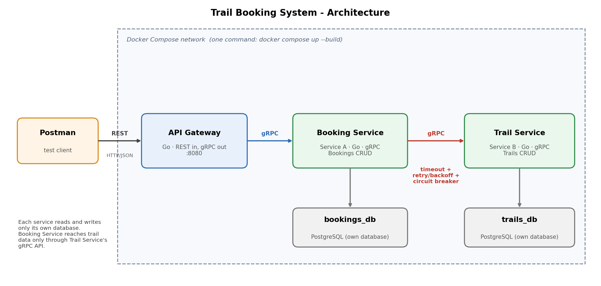

# Trail Booking System

A small distributed application built for **WEB303 - Microservices & Serverless Applications**.
It consists of two collaborating Go microservices behind a REST API gateway. Hikers can browse
trails and book a hike; a booking can only be made for a trail that really exists.

| Component | Role | Owns |
|---|---|---|
| **API Gateway** | Single REST entry point (REST in, gRPC out) | nothing |
| **Trail Service** (Service B) | Manages hiking trails | `trails_db` (PostgreSQL) |
| **Booking Service** (Service A) | Manages bookings; calls Trail Service over gRPC | `bookings_db` (PostgreSQL) |

## Architecture



- Postman (or any REST client) talks **only to the gateway**.
- The gateway forwards requests to the services over **gRPC** and maps gRPC errors to HTTP status codes.
- The Booking Service calls the Trail Service over gRPC to confirm that a trail exists, protected by a
  **timeout, retries with exponential backoff and a circuit breaker**.
- **Database per Service:** the two services never share a database or read each other's tables.
  Trail data is reachable from the Booking Service only through the Trail Service's gRPC API.
- **Bounded contexts:** trails (catalogue) and bookings (reservations) are separate domains with their own models.

## Tech stack

Go 1.25 · gRPC + Protocol Buffers · PostgreSQL 16 · Docker (multi-stage builds) · Docker Compose ·
[`sony/gobreaker`](https://github.com/sony/gobreaker) for the circuit breaker.

## How to run

**Prerequisites:** Docker Desktop (with Docker Compose). Go is only needed if you want to change the `.proto` files.

```bash
# 1. Create your environment file (ports and database settings live here)
cp .env.example .env            # Windows PowerShell: copy .env.example .env

# 2. Build and start everything: gateway, both services and both databases
docker compose up --build
```

When you see `API gateway listening on :8080`, check it works:

```bash
curl http://localhost:8080/health      # -> {"status":"ok"}
```

Then import `postman/trailbooking.postman_collection.json` into Postman and run the folders in order.

Stop everything with `Ctrl+C`. To also delete the database data (fresh start):

```bash
docker compose down -v
```

## Configuration (environment variables)

Nothing is hard-coded. Docker Compose reads `.env` and passes the values to each container.

| Variable | Used by | Meaning |
|---|---|---|
| `GATEWAY_PORT` | gateway, compose | HTTP port of the gateway (default in `.env.example`: 8080) |
| `TRAIL_SERVICE_PORT` | trail-service, others | gRPC port of the Trail Service (50051) |
| `BOOKING_SERVICE_PORT` | booking-service, gateway | gRPC port of the Booking Service (50052) |
| `TRAIL_DB_USER`, `TRAIL_DB_PASSWORD`, `TRAIL_DB_NAME` | trail-db, trail-service | Trail database credentials |
| `BOOKING_DB_USER`, `BOOKING_DB_PASSWORD`, `BOOKING_DB_NAME` | booking-db, booking-service | Booking database credentials |
| `TRAIL_SERVICE_ADDR` | booking-service, gateway | Address of the Trail Service (set in compose) |
| `BOOKING_SERVICE_ADDR` | gateway | Address of the Booking Service (set in compose) |
| `TRAIL_TIMEOUT_MS` *(optional)* | booking-service | Timeout per call to Trail Service (default 2000) |
| `TRAIL_MAX_ATTEMPTS` *(optional)* | booking-service | Total attempts per call (default 3) |
| `TRAIL_BACKOFF_MS` *(optional)* | booking-service | First retry delay, doubles each retry (default 200) |
| `BREAKER_FAILURES` *(optional)* | booking-service | Consecutive failed calls before the circuit opens (default 3) |
| `BREAKER_OPEN_SECONDS` *(optional)* | booking-service | How long the circuit stays open (default 10) |
| `GATEWAY_TIMEOUT_SECONDS` *(optional)* | gateway | Max time for a downstream gRPC call (default 10) |

## REST API (via the gateway, `http://localhost:8080`)

| Method | URL | Description | Success |
|---|---|---|---|
| POST | `/trails` | Create a trail | 201 |
| GET | `/trails` | List trails | 200 |
| GET | `/trails/{id}` | Get one trail | 200 |
| PUT | `/trails/{id}` | Update a trail | 200 |
| DELETE | `/trails/{id}` | Delete a trail | 204 |
| POST | `/bookings` | Create a booking (checks the trail exists) | 201 |
| GET | `/bookings` | List bookings (with trail names) | 200 |
| GET | `/bookings/{id}` | Get one booking (with trail name) | 200 |
| PUT | `/bookings/{id}` | Update a booking | 200 |
| DELETE | `/bookings/{id}` | Delete a booking | 204 |
| GET | `/health` | Gateway health check | 200 |

### Example

```http
POST /trails
{ "name": "Tiger's Nest", "difficulty": "HARD", "distance_km": 10, "max_group_size": 12 }
```
```http
POST /bookings
{ "trail_id": "<id from above>", "hiker_name": "Pema Wangmo", "hike_date": "2026-12-20", "group_size": 3 }
```

### Error handling: gRPC status to HTTP status

| gRPC status | HTTP status | Example |
|---|---|---|
| `INVALID_ARGUMENT` | 400 | empty name, bad date, group too large, malformed JSON |
| `NOT_FOUND` | 404 | unknown trail or booking id |
| `UNAVAILABLE` | 503 | Trail Service is down or the circuit breaker is open |
| `DEADLINE_EXCEEDED` | 504 | a downstream call took too long |
| `INTERNAL` | 500 | unexpected error (details are logged, never sent to the client) |

Errors always have the same JSON shape: `{ "error": "...", "code": "NOT_FOUND", "status": 404 }`.

## Validation

Validation happens in the services (and the gateway rejects malformed JSON). Invalid data is rejected and never stored.

| Resource | Rules |
|---|---|
| Trail | `name` required (max 100 chars); `difficulty` is `EASY`, `MODERATE` or `HARD`; `distance_km` > 0; `max_group_size` > 0 |
| Booking | `trail_id` required and must exist; `hiker_name` required (max 100 chars); `hike_date` is a valid `YYYY-MM-DD` date, not in the past; `group_size` > 0 and not above the trail's `max_group_size` |

## Resilience (Booking Service to Trail Service)

Implemented in `booking-service/trailclient.go`.

1. **Timeout:** every attempt has a 2 s deadline, so a slow or dead Trail Service can never make a request hang.
2. **Retry with exponential backoff:** up to 3 attempts, waiting 200 ms then 400 ms. Only temporary errors
   (`UNAVAILABLE`, `DEADLINE_EXCEEDED`) are retried; `NOT_FOUND` and similar errors are not.
3. **Circuit breaker:** after 3 consecutive failed calls the circuit **opens** for 10 s and calls fail instantly
   ("circuit breaker open") instead of piling up. After 10 s one trial call is allowed (**half-open**); if it
   succeeds the circuit **closes** again. Business errors such as `NOT_FOUND` do not count as failures.

**Behaviour when the Trail Service is stopped:**

- `POST /bookings` returns **503** with a clear message, because a booking cannot be confirmed without checking the trail.
- `GET /bookings` and `GET /bookings/{id}` still return **200**, using the fallback trail name
  `unavailable (trail service is down)` (graceful degradation).

Try it: `docker compose stop trail-service`, send `POST /bookings` four times, then
`docker compose start trail-service` and wait about 10 seconds.

## Project structure

```
trailbooking/
├── proto/                    # Protocol Buffer definitions (trail.proto, booking.proto)
├── gen/                      # Generated Go code from the .proto files
├── trail-service/            # Service B: main.go, server.go, store.go, validation.go, Dockerfile
├── booking-service/          # Service A: main.go, server.go, store.go, validation.go,
│                             #            trailclient.go (resilience), Dockerfile
├── gateway/                  # API gateway: main.go, handlers_*.go, httpx.go, Dockerfile
├── postman/                  # Exported Postman collection
├── docs/                     # Architecture diagram
├── docker-compose.yml        # Whole system: 3 Go services + 2 PostgreSQL databases
├── .env.example              # Template for configuration
└── generate.sh               # Regenerates gen/ from proto/
```

Each service follows the same layout: `main.go` (configuration and wiring), `server.go` (gRPC handlers),
`store.go` (all SQL), `validation.go` (input rules).

## Regenerating the protobuf code (only after editing a `.proto` file)

```bash
./generate.sh
```

Requires `protoc`, `protoc-gen-go` and `protoc-gen-go-grpc` on your PATH.
